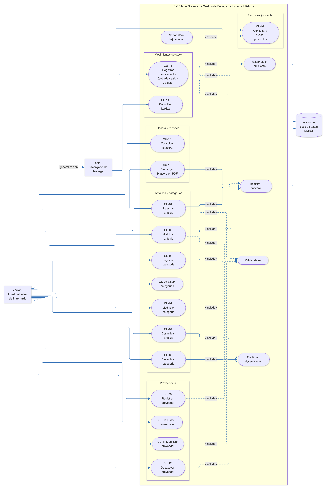

# 3. Diagrama de Casos de Uso UML

## 3.1 Diagrama

> Fuentes editables: [`diagramas/casos_de_uso.mmd`](diagramas/casos_de_uso.mmd) (Mermaid, origen de la imagen) y [`diagramas/casos_de_uso.puml`](diagramas/casos_de_uso.puml) (equivalente en PlantUML).

**Organización por menú (versión final):** *Productos* es solo de consulta (CU-02). Las operaciones que modifican el catálogo —registrar, modificar y desactivar artículos (CU-01, CU-03, CU-04) y el mantenedor de categorías (CU-05 a CU-08)— se concentran en **Artículos y categorías**. El apartado **Bitácora y reportes** agrega la consulta de la bitácora (CU-15) y su descarga en PDF (CU-16).

**Lectura del diagrama:**
- El **Administrador de inventario** es una especialización del **Encargado de bodega** (generalización entre actores): puede hacer todo lo que hace el encargado y además administrar el maestro de datos.
- `<<include>>`: comportamiento que **siempre** se ejecuta como parte del caso base. Por ejemplo, todo registro o modificación valida datos y registra auditoría.
- `<<extend>>`: comportamiento **opcional o condicional**. La alerta de stock bajo el mínimo solo aparece al consultar productos cuando `Stock <= StockMinimo`.
- La **Base de datos MySQL** es un actor secundario: aplica la validación de stock y guarda la auditoría desde los SPs.

## 3.2 Trazabilidad casos de uso ↔ requerimientos ↔ implementación

| Caso de uso | Operación CRUD | RF | Procedimiento almacenado | Ventana (UI) |
|---|---|---|---|---|
| CU-01 Registrar artículo | Create | RF-01 | `sp_producto_insertar` | Artículos y categorías → Gestión de artículos |
| CU-02 Consultar / buscar productos | Read | RF-02, RF-15 | `sp_producto_listar` | Productos (solo lectura) |
| CU-03 Modificar artículo | Update | RF-03 | `sp_producto_actualizar` | Artículos y categorías → Gestión de artículos |
| CU-04 Desactivar artículo | Delete (lógico) | RF-04 | `sp_producto_eliminar` | Artículos y categorías → Gestión de artículos |
| CU-05 Registrar categoría | Create | RF-05 | `sp_categoria_insertar` | Artículos y categorías → Categorías |
| CU-06 Listar categorías | Read | RF-06 | `sp_categoria_listar` | Artículos y categorías → Categorías |
| CU-07 Modificar categoría | Update | RF-07 | `sp_categoria_actualizar` | Artículos y categorías → Categorías |
| CU-08 Desactivar categoría | Delete (lógico) | RF-08 | `sp_categoria_eliminar` | Artículos y categorías → Categorías |
| CU-09 Registrar proveedor | Create | RF-09 | `sp_proveedor_insertar` | VentanaProveedores |
| CU-10 Listar proveedores | Read | RF-10 | `sp_proveedor_listar` | VentanaProveedores |
| CU-11 Modificar proveedor | Update | RF-11 | `sp_proveedor_actualizar` | VentanaProveedores |
| CU-12 Desactivar proveedor | Delete (lógico) | RF-12 | `sp_proveedor_eliminar` | VentanaProveedores |
| CU-13 Registrar movimiento | Create | RF-13 | `sp_movimiento_registrar` | VentanaMovimientos |
| CU-14 Consultar kardex | Read | RF-14 | `sp_movimiento_listar` | VentanaMovimientos |
| CU-15 Consultar bitácora | Read | RF-17 | — (archivos `logs/*.log`) | Bitácora y reporte PDF |
| CU-16 Descargar bitácora en PDF | Export | RF-18 | — (QuestPDF) | Bitácora y reporte PDF |

## 3.3 Especificación de casos de uso principales

### CU-01 Registrar artículo

| Campo | Descripción |
|---|---|
| **Actor principal** | Administrador de inventario |
| **Precondición** | La aplicación está conectada a la BD y existe al menos una categoría y un proveedor activos. |
| **Postcondición** | El producto queda registrado con stock 0, estado activo y auditoría de creación. |
| **Flujo básico** | 1. El actor abre *Artículos y categorías → Gestión de artículos* y presiona **Nuevo**. 2. Ingresa SKU, nombre, descripción, categoría, proveedor, precios, stock mínimo, vencimiento y si requiere receta. 3. Presiona **Guardar**. 4. La UI valida el formato de los números. 5. La BLL valida las reglas de negocio (*include* Validar datos). 6. La DAL ejecuta `sp_producto_insertar`. 7. La BD guarda el registro y la auditoría (*include* Registrar auditoría). 8. El sistema muestra "Registro creado correctamente" y selecciona el producto en la grilla. |
| **Flujos alternativos** | 4a. Un precio no es numérico: se muestra "Precio de compra debe ser un número válido". 5a. Faltan datos, el SKU tiene formato inválido, el precio de venta es menor que el de compra o el vencimiento no es futuro: se muestran **todos** los errores juntos y no se guarda. 6a. El SKU ya existe (error 1062): "Ya existe un registro con ese valor". 6b. No hay conexión: "No se pudo conectar con el servidor MySQL" y el detalle queda en la bitácora. |
| **Seguridad** | A.8.26 / A.8.28: validación en tres capas y SP parametrizado. A.8.15: `UsuarioCreacion`. |

### CU-03 Modificar artículo

| Campo | Descripción |
|---|---|
| **Actor principal** | Administrador de inventario |
| **Precondición** | El producto existe y está seleccionado en la grilla. |
| **Postcondición** | Los datos quedan actualizados, `Version` aumenta en 1 y se registra la auditoría de modificación. |
| **Flujo básico** | 1. El actor selecciona un producto y el formulario se carga con sus datos (*Editando: SKU - Nombre*). 2. Modifica los campos permitidos (el stock es de solo lectura). 3. Presiona **Guardar**. 4. Se valida igual que en CU-01. 5. Se ejecuta `sp_producto_actualizar` con el `Version` leído. 6. Se informa el éxito y se recarga la grilla. |
| **Flujos alternativos** | 5a. Otro usuario modificó el producto entre la lectura y el guardado: el SP devuelve "El producto no existe o fue modificado por otro usuario". El actor debe refrescar y repetir. |
| **Seguridad** | Integridad mediante concurrencia optimista. A.8.15: `UsuarioModificacion` y `FechaModificacion`. |

### CU-04 Desactivar artículo

| Campo | Descripción |
|---|---|
| **Actor principal** | Administrador de inventario |
| **Precondición** | El producto está seleccionado. |
| **Postcondición** | El producto queda con `Activo = 0` y su kardex se conserva. |
| **Flujo básico** | 1. El actor presiona **Desactivar**. 2. El sistema pide confirmación (*include* Confirmar desactivación). 3. El actor confirma. 4. La BLL verifica que el stock sea 0. 5. Se ejecuta `sp_producto_eliminar`. 6. El producto deja de verse en la lista de activos. |
| **Flujos alternativos** | 3a. El actor cancela y no se hace nada. 4a. El stock es mayor que 0: "No se puede eliminar … porque tiene N unidades en stock. Registre primero una salida o un ajuste a 0". |
| **Seguridad** | A.5.33: sin borrado físico; la FK `ON DELETE RESTRICT` protege el historial. |

### CU-13 Registrar movimiento de stock

| Campo | Descripción |
|---|---|
| **Actor principal** | Encargado de bodega |
| **Precondición** | El producto está activo. |
| **Postcondición** | Existe un nuevo registro en `MovimientoStock` y `Producto.Stock` quedó actualizado en la misma transacción. |
| **Flujo básico** | 1. El actor abre *Movimientos de stock*. 2. Selecciona el producto y ve su stock actual y su kardex. 3. Elige el tipo (ENTRADA, SALIDA o AJUSTE), la cantidad, el motivo y el documento. 4. Presiona **Registrar movimiento**. 5. La UI valida que la cantidad sea un entero. 6. La BLL valida que la cantidad sea mayor que 0 y que SALIDA y AJUSTE tengan motivo. 7. `sp_movimiento_registrar` bloquea la fila del producto, calcula el nuevo stock (*include* Validar stock suficiente), inserta el movimiento, actualiza el stock y confirma (COMMIT). 8. Se muestra "stock anterior X, stock nuevo Y" y se actualiza el kardex. |
| **Flujos alternativos** | 7a. Una SALIDA supera el stock: ROLLBACK y mensaje "Stock insuficiente para la salida". 7b. El producto fue desactivado: "Producto inexistente o inactivo". |
| **Seguridad** | Integridad transaccional (todo o nada). A.8.15: el movimiento registra usuario, fecha y documento y no se puede editar ni borrar desde la aplicación. |

### CU-14 Consultar kardex

| Campo | Descripción |
|---|---|
| **Actor principal** | Encargado de bodega |
| **Flujo básico** | 1. El actor selecciona un producto en *Movimientos de stock*. 2. El sistema ejecuta `sp_movimiento_listar` y muestra los movimientos del más reciente al más antiguo. 3. Opcionalmente marca "Ver movimientos de todos los productos". |
| **Seguridad** | A.8.16: permite revisar quién hizo cada cambio de inventario. |

### CU-05 a CU-12 (Categorías y Proveedores)

Siguen el mismo patrón que CU-01 a CU-04 (Nuevo → Guardar → validar → SP → auditoría; Desactivar → confirmar → baja lógica). Diferencias específicas:

- **Categorías:** el nombre es obligatorio y único, con un máximo de 60 caracteres.
- **Proveedores:** el RUT es obligatorio, se valida con el algoritmo **módulo 11** y se guarda normalizado (`12345678-9`). El email se valida con una expresión regular y el teléfono solo admite números, espacios y `+`.
- Una categoría o un proveedor desactivado deja de aparecer en los combos de productos, pero los productos existentes conservan su referencia.

### CU-02 Consultar / buscar productos

| Campo | Descripción |
|---|---|
| **Actor principal** | Encargado de bodega |
| **Flujo básico** | 1. El actor abre *Productos*. 2. Escribe un SKU o nombre y presiona **Buscar** (o Enter). 3. El sistema ejecuta `sp_producto_listar` y muestra categoría, proveedor, precios, stock, estado de stock y vencimiento. 4. Opcionalmente marca "Mostrar inactivos". |
| **Restricción** | La ventana es de **solo lectura**: no tiene formulario ni botones Guardar o Desactivar, y seleccionar una fila no la abre para edición. |
| **Seguridad** | A.8.3: lectura solo mediante SP. Separar consulta y gestión reduce las modificaciones accidentales. |

### CU-15 Consultar bitácora y CU-16 Descargar bitácora en PDF

| Campo | Descripción |
|---|---|
| **Actor principal** | Administrador de inventario (auditor) |
| **Precondición** | La aplicación registró eventos en `logs/sigbim-AAAAMMDD.log`. |
| **Flujo básico** | 1. El actor abre *Bitácora y reporte PDF*. 2. El sistema lee los archivos de la bitácora y muestra los eventos (más reciente primero): fecha, nivel, usuario, operación y detalle (CU-15). 3. El actor presiona **Descargar PDF** y elige dónde guardarlo. 4. El sistema genera el PDF con encabezado, resumen por usuario y por operación, y el detalle cronológico. 5. Registra la exportación en la bitácora (*include* Registrar auditoría) y abre el PDF (CU-16). |
| **Flujos alternativos** | 3a. El actor cancela el diálogo: no se genera nada. 4a. No se puede escribir el archivo: se muestra "Error inesperado" y el detalle queda en la bitácora. |
| **Seguridad** | A.8.15 / A.8.16: trazabilidad completa, incluida la de quién exportó la bitácora. A.8.12: la bitácora no contiene contraseñas. |
