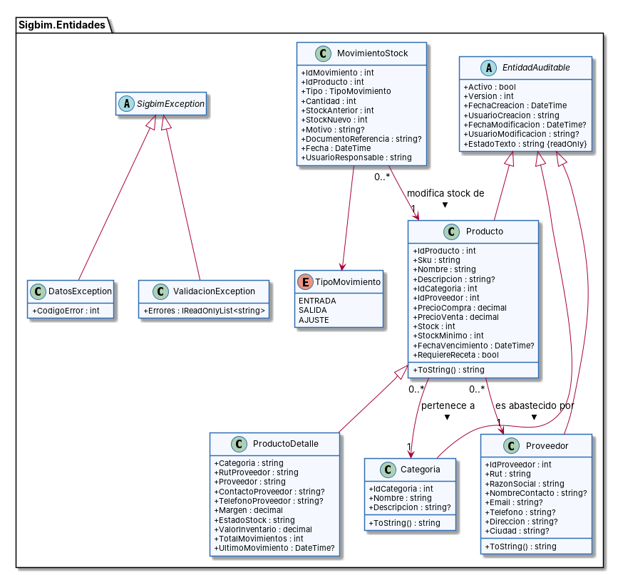
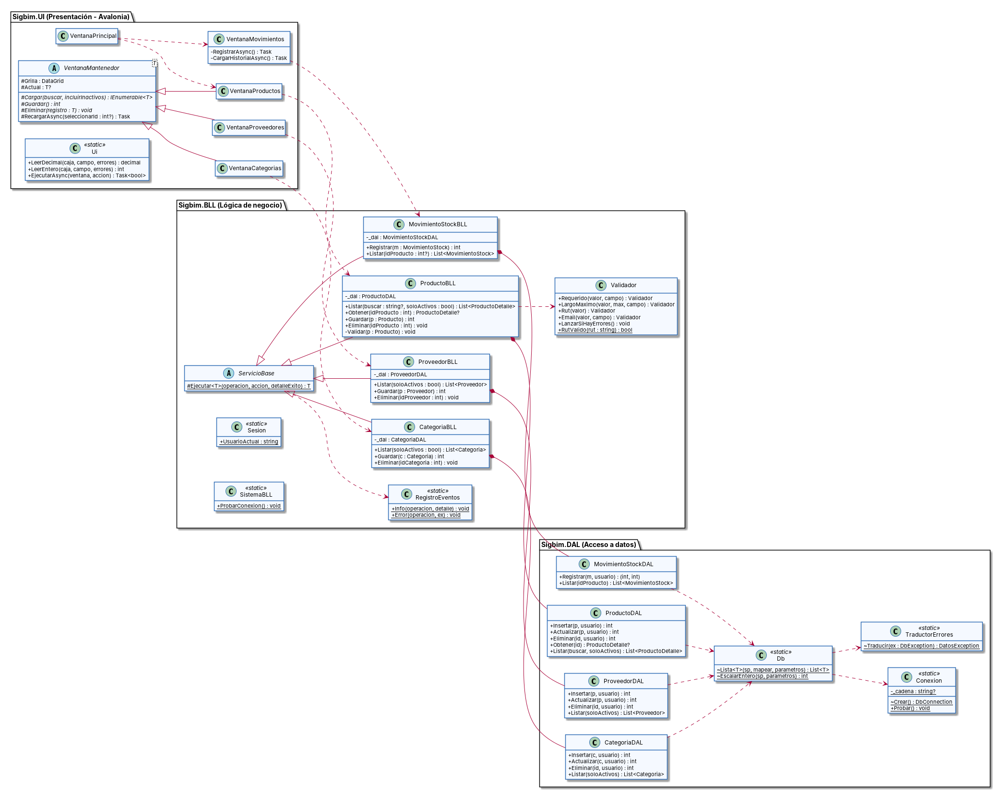

# 4. Diagrama de Clases UML

El diseño se presenta en dos diagramas:

1. **Modelo de dominio** (capa de Entidades): las clases que representan los datos del negocio y sus relaciones.
2. **Clases por capa** (UI, BLL y DAL): los métodos principales y las dependencias entre capas.

**Notación de visibilidad:** `+` público · `-` privado · `#` protegido · `~` interno (internal) · subrayado = estático.

## 4.1 Modelo de dominio (Sigbim.Entidades)

> Fuente: [`diagramas/clases_dominio.puml`](diagramas/clases_dominio.puml)

### Relaciones

| Relación | Tipo UML | Multiplicidad | Justificación (requerimiento) |
|---|---|---|---|
| `Categoria`, `Proveedor`, `Producto` → `EntidadAuditable` | Generalización (herencia) | — | Los campos de auditoría y la baja lógica son comunes (RNF-04, A.8.15). |
| `ProductoDetalle` → `Producto` | Generalización | — | Agrega los datos de la vista consolidada sin duplicar la clase (RF-15). |
| `Producto` → `Categoria` | Asociación dirigida | 0..* a 1 | Todo producto pertenece a exactamente una categoría (RF-01). |
| `Producto` → `Proveedor` | Asociación dirigida | 0..* a 1 | Todo producto tiene un proveedor principal (RF-01). |
| `MovimientoStock` → `Producto` | Asociación dirigida | 0..* a 1 | Un producto acumula muchos movimientos (RF-13, RF-14). |
| `MovimientoStock` → `TipoMovimiento` | Dependencia (enumeración) | 1 | Restringe los tipos a ENTRADA, SALIDA y AJUSTE. |
| `ValidacionException`, `DatosException` → `SigbimException` | Generalización | — | Permite a la UI distinguir errores de negocio de errores de BD (criterio 7 de la rúbrica). |

### Decisiones de diseño
- Las asociaciones se implementan con **claves foráneas** (`IdCategoria`, `IdProveedor`, `IdProducto`), igual que en el modelo relacional. Así las clases "conversan" directamente con las tablas.
- `Stock` es una propiedad de **solo lectura** para la UI: solo cambia mediante `MovimientoStock` (RNF-06).
- `EstadoTexto` es una propiedad **calculada** (no se almacena).

## 4.2 Clases por capa (UI, BLL y DAL)

> Fuente: [`diagramas/clases_capas.puml`](diagramas/clases_capas.puml)

### Responsabilidades

| Capa | Clase | Responsabilidad |
|---|---|---|
| UI | `VentanaMantenedor<T>` | Plantilla genérica CRUD (patrón *Template Method*): grilla, formulario y botones. Las clases hijas solo implementan `Cargar`, `Guardar`, `Eliminar` y `MostrarEnFormulario`. |
| UI | `VentanaProductos`, `VentanaCategorias`, `VentanaProveedores` | Mantenedores concretos. |
| UI | `VentanaMovimientos` | Registro de movimientos y kardex. |
| UI | `Ui` | Validación de formato (números) y manejo centralizado de excepciones (`EjecutarAsync`). |
| BLL | `ServicioBase` | Ejecuta cada operación registrando el éxito o el error en la bitácora. |
| BLL | `ProductoBLL`, `CategoriaBLL`, `ProveedorBLL`, `MovimientoStockBLL` | Reglas de negocio y validaciones antes de llamar a la DAL. |
| BLL | `Validador` | Validaciones reutilizables con interfaz fluida (requerido, largo, email, RUT módulo 11). |
| BLL | `Sesion`, `RegistroEventos`, `SistemaBLL` | Usuario actual, bitácora (A.8.15) y verificación de conexión. |
| DAL | `ProductoDAL`, `CategoriaDAL`, `ProveedorDAL`, `MovimientoStockDAL` | Invocan **solo procedimientos almacenados** y convierten filas en entidades. |
| DAL | `Db` | Ejecución común: abre la conexión, arma el comando `CALL sp_x(@p…)` y agrega los parámetros. |
| DAL | `Conexion` | Lee la cadena de conexión desde configuración externa (A.5.17). |
| DAL | `TraductorErrores` | Convierte códigos de error MySQL (1062, 1451, 1644…) en mensajes de usuario (A.8.12). |

### Relaciones entre capas
- **Composición** `ProductoBLL *-- ProductoDAL`: cada servicio de negocio crea y posee su objeto de acceso a datos (también se puede inyectar por constructor para pruebas).
- **Dependencias** (`..>`): la UI depende de la BLL, la BLL de la DAL y la DAL de `Db`. Ninguna capa inferior conoce a una superior.
