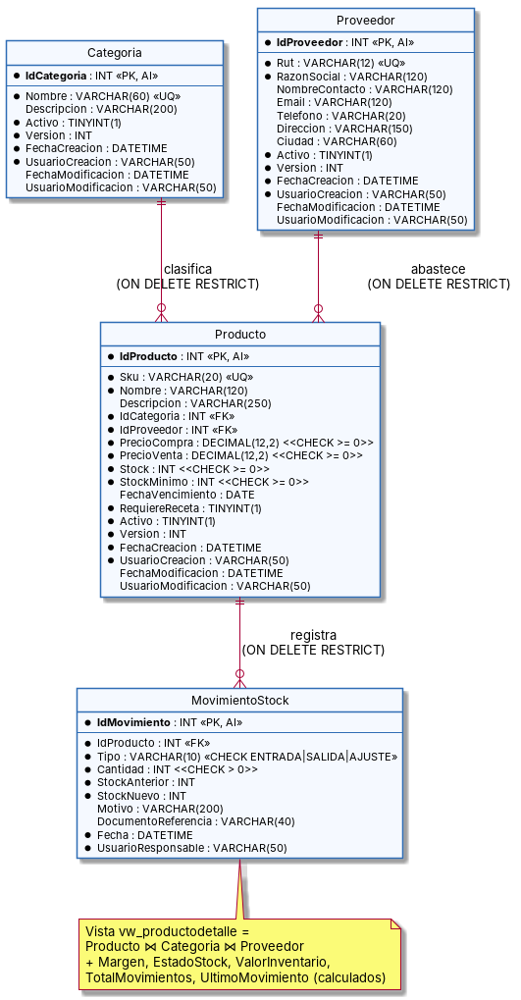

# 5. Modelo relacional y normalización

## 5.1 Transformación del modelo de clases al modelo relacional

| Clase (UML) | Tabla | Regla de transformación aplicada |
|---|---|---|
| `Categoria` | `Categoria` | Cada clase persistente se convierte en tabla; su identificador pasa a ser PK `AUTO_INCREMENT`. |
| `Proveedor` | `Proveedor` | Igual que la anterior. `Rut` es clave candidata (`UNIQUE`). |
| `Producto` | `Producto` | Las asociaciones 0..* → 1 se convierten en **FK** en el lado "muchos" (`IdCategoria`, `IdProveedor`). |
| `MovimientoStock` | `MovimientoStock` | Asociación 0..* → 1 con Producto → FK `IdProducto`. |
| `EntidadAuditable` (abstracta) | — (sin tabla propia) | Herencia resuelta como **tabla por clase concreta**: sus columnas se repiten en cada tabla hija. |
| `ProductoDetalle` | Vista `vw_productodetalle` | Clase de consulta: se implementa como **vista**, no como tabla, para no duplicar datos. |
| `TipoMovimiento` (enum) | Columna `Tipo` + `CHECK` | La enumeración se restringe con `CHECK (Tipo IN ('ENTRADA','SALIDA','AJUSTE'))`. |

## 5.2 Diagrama del modelo relacional

> Fuente: [`diagramas/modelo_relacional.puml`](diagramas/modelo_relacional.puml). El script completo está en [`/database/01_sigbim_inventario.sql`](../database/01_sigbim_inventario.sql).

## 5.3 Proceso de normalización

### Forma no normalizada (planilla Excel actual)

Así se lleva hoy la bodega: una fila por producto, con los movimientos agregados como columnas repetidas.

| Sku | Producto | Categoria | DescCategoria | RutProv | Proveedor | FonoProv | PrecioCompra | PrecioVenta | Stock | Mov1 (fecha, tipo, cant) | Mov2 (fecha, tipo, cant) | … |
|---|---|---|---|---|---|---|---|---|---|---|---|---|
| GUA-001 | Guantes nitrilo M | Insumos clínicos | Gasas, guantes… | 76123456-0 | Distrib. Médica Sur | +5622… | 4500 | 6990 | 85 | 01-10, ENTRADA, 100 | 05-10, SALIDA, 15 | … |

**Problemas:** grupos repetitivos (Mov1, Mov2…), valores no atómicos ("fecha, tipo, cant" en una celda) y datos de proveedor y categoría repetidos en cada producto.

### Primera Forma Normal (1FN)

> **Regla:** todos los atributos son atómicos y no hay grupos repetitivos.

Se separa cada movimiento en su propia fila y cada dato en su propia columna. La clave pasa a ser compuesta: **(Sku, FechaMovimiento)**.

`R1 (`**`Sku`**`, `**`FechaMovimiento`**`, Producto, Categoria, DescCategoria, RutProv, Proveedor, FonoProv, PrecioCompra, PrecioVenta, Stock, TipoMov, Cantidad, StockAnterior, StockNuevo, Motivo, UsuarioMov)`

**Problema que persiste:** los datos del producto se repiten en cada movimiento (dependencia parcial).

### Segunda Forma Normal (2FN)

> **Regla:** estar en 1FN y que todo atributo no clave dependa de la **clave completa**, no de una parte de ella.

Dependencias parciales detectadas:
- `Sku → Producto, Categoria, DescCategoria, RutProv, Proveedor, FonoProv, PrecioCompra, PrecioVenta, Stock`. Dependen solo de `Sku`, no de la fecha.

Se descompone en:
- `Producto (`**`Sku`**`, Nombre, Categoria, DescCategoria, RutProv, Proveedor, FonoProv, PrecioCompra, PrecioVenta, Stock, StockMinimo, FechaVencimiento, RequiereReceta)`
- `MovimientoStock (`**`IdMovimiento`**`, Sku (FK), Fecha, Tipo, Cantidad, StockAnterior, StockNuevo, Motivo, DocumentoReferencia, UsuarioResponsable)`

Se agrega `IdMovimiento` como clave sustituta, porque dos movimientos del mismo producto pueden ocurrir en el mismo segundo.

**Problema que persiste:** en `Producto`, los datos del proveedor dependen del RUT y no del SKU (dependencia transitiva).

### Tercera Forma Normal (3FN)

> **Regla:** estar en 2FN y que ningún atributo no clave dependa de otro atributo no clave (sin dependencias transitivas).

Dependencias transitivas detectadas en `Producto`:
- `Sku → RutProv → Proveedor, FonoProv, Email, Direccion…`
- `Sku → Categoria → DescCategoria`

Se descompone en:
- `Categoria (`**`IdCategoria`**`, Nombre UQ, Descripcion, …auditoría)`
- `Proveedor (`**`IdProveedor`**`, Rut UQ, RazonSocial, NombreContacto, Email, Telefono, Direccion, Ciudad, …auditoría)`
- `Producto (`**`IdProducto`**`, Sku UQ, Nombre, Descripcion, IdCategoria FK, IdProveedor FK, PrecioCompra, PrecioVenta, Stock, StockMinimo, FechaVencimiento, RequiereReceta, …auditoría)`
- `MovimientoStock (`**`IdMovimiento`**`, IdProducto FK, Tipo, Cantidad, StockAnterior, StockNuevo, Motivo, DocumentoReferencia, Fecha, UsuarioResponsable)`

Se usan **claves sustitutas** (`Id…` autoincrementales) en lugar de `Sku` y `Rut` como PK. Así, si cambia un SKU o se corrige un RUT, no hay que propagar el cambio a las tablas relacionadas. `Sku` y `Rut` se mantienen como **claves candidatas** con `UNIQUE`.

### Atributos derivados (no almacenados)

`Margen`, `EstadoStock`, `ValorInventario`, `TotalMovimientos` y `UltimoMovimiento` se pueden calcular a partir de otros datos. Por eso **no se guardan** en tablas: se calculan en la vista `vw_productodetalle`. Así nunca pueden quedar desactualizados.

### Redundancia controlada (justificación)

- **`Producto.Stock`:** en teoría se podría calcular sumando los movimientos. Se mantiene almacenado por rendimiento y como *saldo actual*, con estas garantías: solo cambia dentro de `sp_movimiento_registrar`, en la misma transacción que inserta el movimiento, con bloqueo `FOR UPDATE`. La UI no puede editarlo.
- **`StockAnterior` / `StockNuevo` en `MovimientoStock`:** no son redundancia. Son un **hecho histórico** (fotografía del stock en ese instante) que exige el kardex y la auditoría (A.8.15).

## 5.4 Integridad

| Tipo de integridad | Implementación |
|---|---|
| **De entidad** | PK en las 4 tablas (`AUTO_INCREMENT`). |
| **Referencial** | FK `Producto.IdCategoria → Categoria`, `Producto.IdProveedor → Proveedor`, `MovimientoStock.IdProducto → Producto`, todas con `ON DELETE RESTRICT` (no se puede borrar un padre con hijos) y `ON UPDATE CASCADE`. |
| **De dominio** | `NOT NULL`; `CHECK` de precios ≥ 0, stock ≥ 0, cantidad > 0 y tipo de movimiento válido; tipos `DECIMAL(12,2)` para dinero; `VARCHAR` con largos definidos. |
| **De unicidad** | `UNIQUE` en `Producto.Sku`, `Proveedor.Rut` y `Categoria.Nombre`. |
| **De negocio (en SPs)** | `SIGNAL SQLSTATE '45000'` para: precio de venta menor que el de compra, stock insuficiente, producto inactivo y conflicto de versión. |
| **Transaccional** | `START TRANSACTION … COMMIT` y `ROLLBACK` automático ante cualquier error en `sp_movimiento_registrar`. |

## 5.5 Procedimientos almacenados

Toda la manipulación de datos se hace **exclusivamente** con SPs. El usuario de la aplicación no tiene permiso para ejecutar SQL directo sobre las tablas (ver `database/02_seguridad_usuario_app.sql`).

| Tabla | Create | Read | Update | Delete (lógico) |
|---|---|---|---|---|
| Categoria | `sp_categoria_insertar` | `sp_categoria_listar` | `sp_categoria_actualizar` | `sp_categoria_eliminar` |
| Proveedor | `sp_proveedor_insertar` | `sp_proveedor_listar` | `sp_proveedor_actualizar` | `sp_proveedor_eliminar` |
| Producto | `sp_producto_insertar` | `sp_producto_listar`, `sp_producto_obtener` | `sp_producto_actualizar` | `sp_producto_eliminar` |
| MovimientoStock | `sp_movimiento_registrar` | `sp_movimiento_listar` | — (inmutable) | — (inmutable) |

### Pruebas ejecutadas sobre los SPs

| Prueba | Resultado esperado | Resultado obtenido |
|---|---|---|
| Entrada de 100 unidades en GUA-001 | Stock 0 → 100 | ✅ |
| Salida de 15 unidades en GUA-001 | Stock 100 → 85 | ✅ |
| Salida de 9999 unidades en PAR-500 (stock 200) | Error "Stock insuficiente para la salida" | ✅ ERROR 1644 |
| Actualizar producto con `Version` desactualizada | Error "fue modificado por otro usuario" | ✅ ERROR 1644 |
| `SELECT * FROM Producto` con usuario `sigbim_app` | Acceso denegado | ✅ ERROR 1142 |
| `CALL sp_categoria_listar(1)` con usuario `sigbim_app` | Lista categorías | ✅ |
