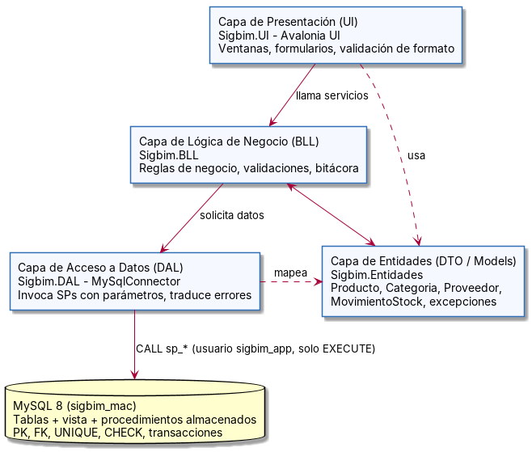
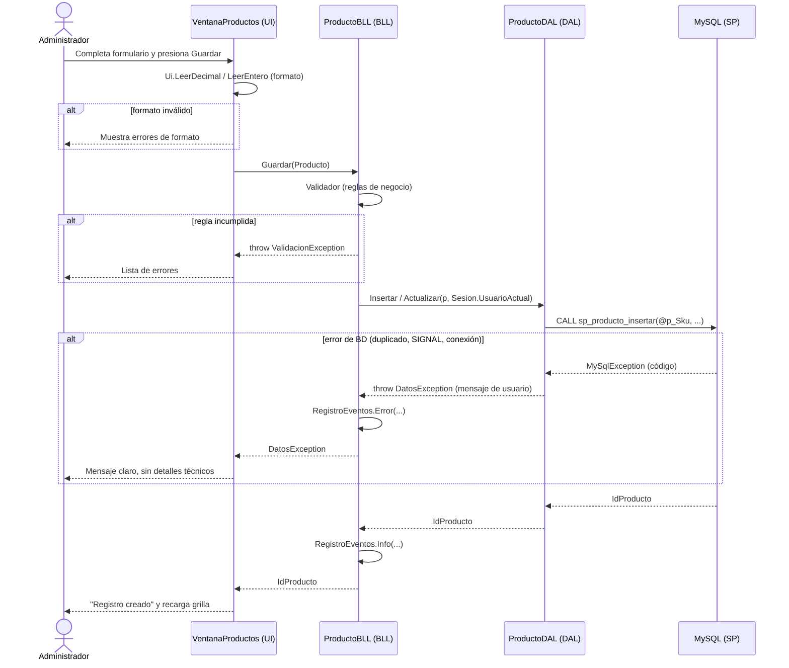
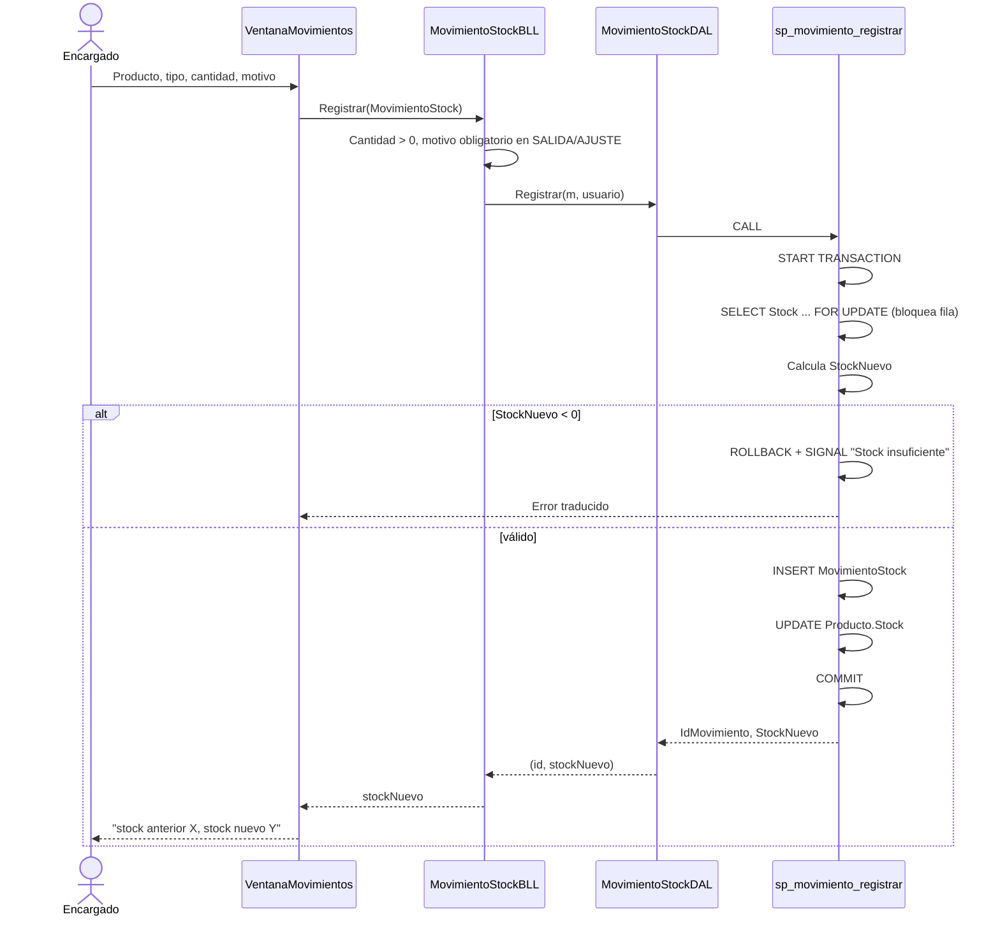

# 6. Diseño de arquitectura de la aplicación

## 6.1 Arquitectura en 4 capas



```
[ CAPA DE PRESENTACIÓN (UI - Avalonia) ]        Sigbim.UI
                │
                ▼
[ CAPA DE LÓGICA DE NEGOCIO (BLL) ] ◄──► [ CAPA DE ENTIDADES (DTO / Models) ]
        Sigbim.BLL                              Sigbim.Entidades
                │
                ▼
[ CAPA DE ACCESO A DATOS (DAL) ]                Sigbim.DAL
                │
                ▼
[ BASE DE DATOS MySQL (Stored Procedures & Integridad Referencial) ]
```

Cada capa es un **proyecto independiente** dentro de la solución `Sigbim.sln`. Las referencias entre proyectos imponen la dirección de las dependencias: el compilador impide, por ejemplo, que la UI llame directamente a la DAL.

| Proyecto | Tipo | Referencia a | Responsabilidad |
|---|---|---|---|
| `Sigbim.Entidades` | Biblioteca de clases | — | Clases del dominio (DTO) y excepciones compartidas. No tiene lógica. |
| `Sigbim.DAL` | Biblioteca de clases | Entidades + paquete `MySqlConnector` | Ejecutar los SPs con parámetros, mapear filas a entidades y traducir errores de MySQL. |
| `Sigbim.BLL` | Biblioteca de clases | Entidades, DAL | Reglas de negocio, validaciones, usuario de sesión y bitácora. |
| `Sigbim.UI` | Aplicación de escritorio | Entidades, BLL (**no** DAL) | Ventanas, formularios, validación de formato y mensajes al usuario. |

## 6.2 Decisión de arquitectura: Avalonia UI en lugar de Windows Forms

| | |
|---|---|
| **Contexto** | La guía propone Windows Forms, pero el desarrollo y la ejecución se hacen en **macOS**. |
| **Problema** | Windows Forms depende de la API Win32 de Windows: **no se puede ejecutar en macOS** (Microsoft no lo soporta). |
| **Decisión** | La capa de presentación usa **Avalonia UI 11**, un framework de escritorio para .NET que funciona en macOS, Windows y Linux. Su modelo es equivalente: ventanas (`Window`), controles (`TextBox`, `ComboBox`, `DataGrid`, `Button`) y eventos (`Click`, `SelectionChanged`). |
| **Consecuencias** | Las capas BLL, DAL y Entidades **no cambian**: son las mismas que se usarían con Windows Forms. Esto demuestra el bajo acoplamiento de la arquitectura, porque cambiar la tecnología de la UI no obliga a tocar el resto del sistema. También se reemplaza SQL Server por **MySQL 8**, que tiene instalador nativo para Mac. |

## 6.3 Flujo de datos

### Guardar un producto (CU-01 / CU-03)



### Registrar un movimiento de stock (CU-13)



## 6.4 Manejo de errores y validaciones por capa

| Capa | Qué valida o captura | Mecanismo |
|---|---|---|
| **UI** | Formato: números válidos, largo máximo de los textos y confirmación antes de desactivar. | `TextBox.MaxLength`, `Ui.LeerDecimal`, `Ui.LeerEntero` y `Ui.ConfirmarAsync`. `Ui.EjecutarAsync` captura **todas** las excepciones y muestra un mensaje adecuado a cada tipo. |
| **BLL** | Reglas de negocio: obligatorios, SKU, RUT módulo 11, email, precios, no desactivar con stock y motivo obligatorio. | `Validador` lanza `ValidacionException` con todos los errores juntos. `ServicioBase.Ejecutar` registra cada error en la bitácora. |
| **DAL** | Excepciones SQL de MySQL. | `catch (DbException)` → `TraductorErrores` → `DatosException` con un mensaje de usuario. El error original queda en `InnerException` para la bitácora. |
| **BD** | Integridad final: PK, FK, UNIQUE, CHECK y reglas en SPs. | Restricciones DDL y `SIGNAL SQLSTATE '45000'`, con `ROLLBACK` en transacciones. |

Jerarquía de excepciones:

```
Exception
 └─ SigbimException (abstracta)
     ├─ ValidacionException   → errores del usuario (lista de mensajes)
     └─ DatosException        → errores de base de datos (CodigoError + mensaje amigable)
```

## 6.5 Estructura de la solución

```
src/
├── Sigbim.sln
├── Sigbim.Entidades/
│   ├── EntidadAuditable.cs
│   ├── Categoria.cs, Proveedor.cs, Producto.cs, ProductoDetalle.cs
│   ├── MovimientoStock.cs   (incluye enum TipoMovimiento)
│   └── Excepciones.cs
├── Sigbim.DAL/
│   ├── Conexion.cs          (lee appsettings.json o la variable SIGBIM_CONEXION)
│   ├── Db.cs                (ejecución de SPs + lectura segura de columnas)
│   ├── TraductorErrores.cs
│   └── CategoriaDAL.cs, ProveedorDAL.cs, ProductoDAL.cs, MovimientoStockDAL.cs
├── Sigbim.BLL/
│   ├── ServicioBase.cs, Validador.cs, Sesion.cs, RegistroEventos.cs, SistemaBLL.cs
│   └── CategoriaBLL.cs, ProveedorBLL.cs, ProductoBLL.cs, MovimientoStockBLL.cs
└── Sigbim.UI/
    ├── Program.cs, App.axaml, App.axaml.cs
    ├── Ui.cs, Dialogo.cs
    ├── appsettings.example.json
    └── Ventanas/
        ├── VentanaPrincipal.cs
        ├── VentanaMantenedor.cs  (plantilla CRUD genérica)
        ├── VentanaProductos.cs, VentanaCategorias.cs, VentanaProveedores.cs
        └── VentanaMovimientos.cs
```

## 6.6 Escalabilidad

- **Agregar un mantenedor nuevo** (por ejemplo, Unidad de Medida) requiere crear su tabla y SPs, su entidad, su DAL, su BLL y una clase que herede de `VentanaMantenedor<T>`, sin modificar el código existente (principio abierto/cerrado).
- **Cambiar de base de datos** (por ejemplo, a SQL Server) solo afecta a `Conexion` y `TraductorErrores` en la DAL, porque el resto usa las abstracciones ADO.NET (`DbConnection`, `DbCommand`).
- **Cambiar la interfaz** (Avalonia, Windows Forms o web) no afecta a BLL, DAL ni Entidades.
