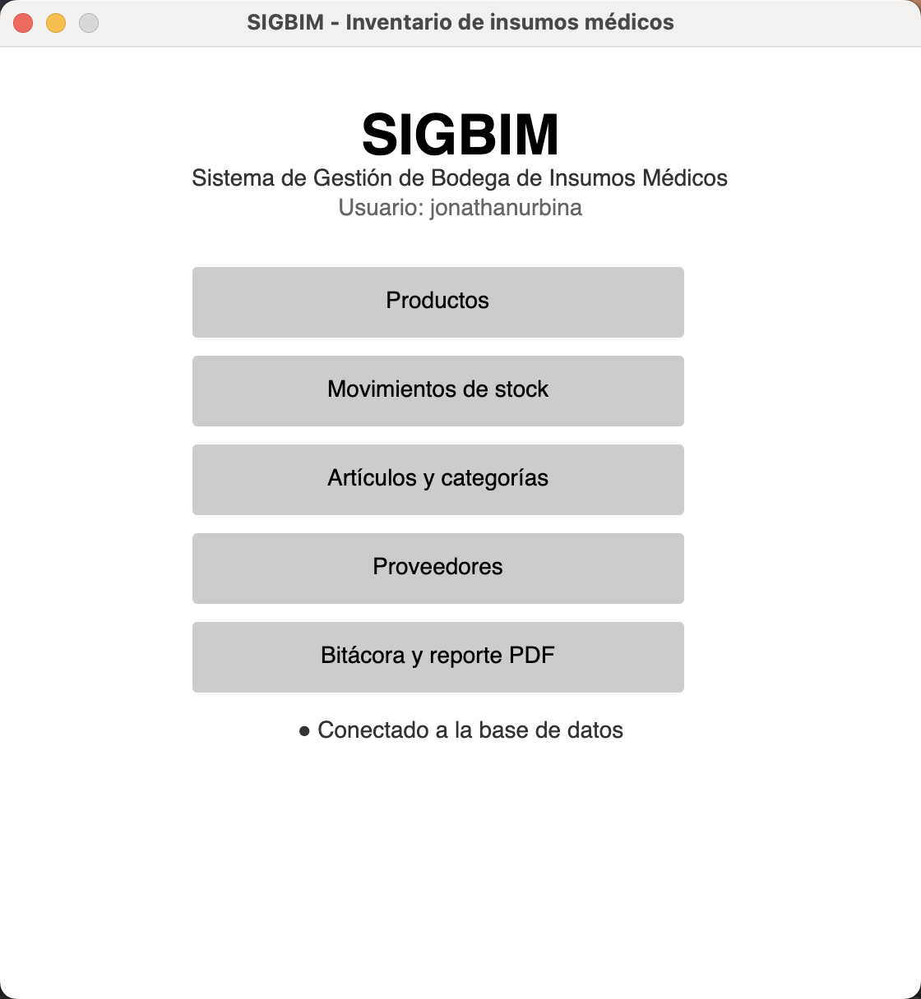
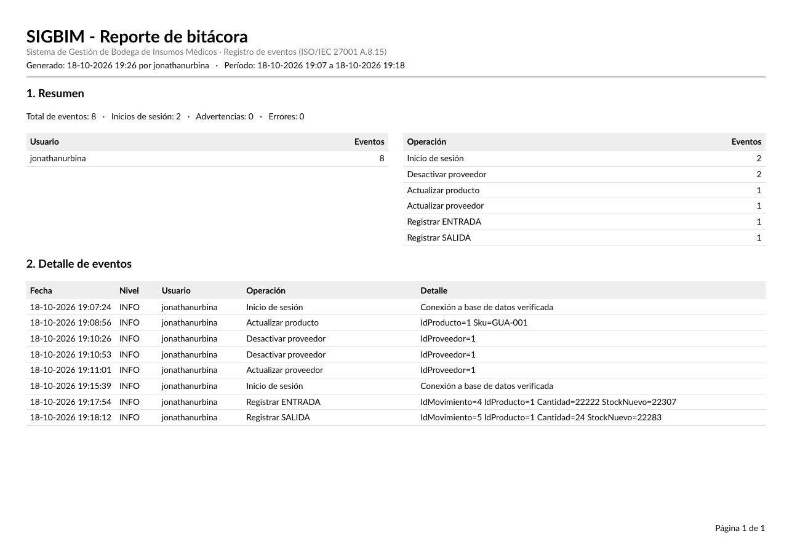

# 7. Plan de pruebas y evidencias

## 7.1 Estrategia

Las pruebas verifican que el mantenedor cumple los requerimientos del documento 02 y que los controles de seguridad funcionan. Se aplicaron en tres niveles, de abajo hacia arriba:

| Nivel | Qué se prueba | Cómo |
|---|---|---|
| **Base de datos** | Restricciones (UNIQUE, CHECK), reglas de los SPs y mínimo privilegio del usuario `sigbim_app`. | Llamadas directas con el cliente `mysql` conectado como `sigbim_app`. |
| **Lógica de negocio (BLL)** | Validaciones antes de llegar a la BD (obligatorios, RUT módulo 11, email, precios, stock). | Programa de consola que invoca los servicios de la BLL. |
| **Aplicación (UI)** | Conexión, menú, CRUD, movimientos, bitácora y reporte PDF. | Ejecución de la aplicación en macOS y revisión de la bitácora `logs/`. |

Las **pruebas negativas** (datos que deben ser rechazados) son prioritarias, porque demuestran que la información no se corrompe (ISO 27001 A.8.29).

**Entorno de prueba:** macOS (Apple Silicon), .NET 8 SDK, MySQL Server 8.0.46, base `sigbim_mac` creada con `database/01_sigbim_inventario.sql`. Fecha de ejecución: 18-10-2026.

## 7.2 Instalación y compilación

| ID | Prueba | Resultado esperado | Resultado obtenido | Estado |
|---|---|---|---|---|
| CP-01 | Ejecutar `01_sigbim_inventario.sql` como `root`. | Se crean la BD, las 4 tablas, la vista, los SPs y los datos de prueba. | 2 categorías, 1 proveedor, 2 productos y 3 movimientos iniciales; la vista devuelve los productos con stock y estado. | ✅ |
| CP-02 | Ejecutar `02_seguridad_usuario_app.sql`. | Se crea `sigbim_app` solo con `EXECUTE`. | `GRANT USAGE ON *.*` y `GRANT EXECUTE ON sigbim_mac.*`. | ✅ |
| CP-03 | `dotnet build` de la solución. | Compila sin errores. | **0 errores, 0 advertencias** (4 proyectos). | ✅ |
| CP-04 | Iniciar la aplicación. | La ventana principal muestra "Conectado a la base de datos" y registra el inicio en la bitácora. | Bitácora: `Inicio de sesión - Conexión a base de datos verificada`. | ✅ |

### Incidente detectado y corregido durante la instalación

| Campo | Detalle |
|---|---|
| **Síntoma** | La aplicación no podía conectarse: `ERROR 1045: Access denied for user 'sigbim_app'@'localhost'`, aunque el usuario existía. |
| **Diagnóstico** | `SELECT user, host FROM mysql.user` mostró **dos** cuentas: `sigbim_app@%` (nueva) y `sigbim_app@localhost` (de una instalación anterior, con otra clave). MySQL elige la cuenta más específica (`localhost`), por lo que rechazaba la clave nueva. |
| **Corrección** | El script `02_seguridad_usuario_app.sql` ahora ejecuta `DROP USER IF EXISTS 'sigbim_app'@'localhost'` antes de crear la cuenta. |
| **Verificación** | `SELECT CURRENT_USER()` devuelve `sigbim_app@%` y los SPs responden. |
| **Control ISO 27001** | A.8.32 Gestión de cambios: la corrección quedó en un commit propio (`fix(db): …`). |

## 7.3 Seguridad: mínimo privilegio (RNF-01, A.8.2 / A.8.3)

| ID | Prueba (como `sigbim_app`) | Resultado esperado | Resultado obtenido | Estado |
|---|---|---|---|---|
| CP-05 | `CALL sp_categoria_listar(1);` | Devuelve las categorías. | Lista "Insumos clínicos" y "Medicamentos". | ✅ |
| CP-06 | `SELECT * FROM Producto;` | Rechazado. | `ERROR 1142: SELECT command denied to user 'sigbim_app'@'localhost' for table 'producto'` | ✅ |
| CP-07 | `UPDATE Producto SET Stock = 0;` | Rechazado (no se puede alterar el stock sin un movimiento). | `ERROR 1142: UPDATE command denied to user 'sigbim_app'@'localhost' for table 'producto'` | ✅ |

## 7.4 Reglas de la base de datos (pruebas negativas)

Todas se ejecutaron como `sigbim_app`. Se verificó que el stock de los productos **no cambió** después de las pruebas (GUA-001: 22.283 y PAR-500: 200, antes y después).

| ID | Prueba | Resultado esperado | Resultado obtenido | Estado |
|---|---|---|---|---|
| CP-08 | SALIDA de 999.999 unidades de PAR-500 (stock 200). | Rechazo y ROLLBACK. | `ERROR 1644: Stock insuficiente para la salida` | ✅ |
| CP-09 | Movimiento con cantidad 0. | Rechazo. | `ERROR 1644: La cantidad debe ser mayor a 0` | ✅ |
| CP-10 | Movimiento con tipo `REGALO`. | Rechazo. | `ERROR 1644: Tipo de movimiento inválido (ENTRADA, SALIDA, AJUSTE)` | ✅ |
| CP-11 | Movimiento para el producto 9999. | Rechazo. | `ERROR 1644: Producto inexistente o inactivo` | ✅ |
| CP-12 | Insertar producto con precio de venta 500 y compra 1.000. | Rechazo. | `ERROR 1644: El precio de venta no puede ser menor al precio de compra` | ✅ |
| CP-13 | Insertar producto con SKU `GUA-001` (ya existe). | Rechazo por UNIQUE. | `ERROR 1062: Duplicate entry 'GUA-001' for key 'producto.UQ_Producto_Sku'` | ✅ |
| CP-14 | Insertar la categoría "Medicamentos" (ya existe). | Rechazo por UNIQUE. | `ERROR 1062: Duplicate entry 'Medicamentos' for key 'categoria.UQ_Categoria_Nombre'` | ✅ |

> En la aplicación, los errores 1062 y 1644 llegan al usuario traducidos por `TraductorErrores` ("Ya existe un registro con ese valor", o el mensaje del SP), sin detalles técnicos (A.8.12).

## 7.5 Validaciones de la lógica de negocio (BLL)

Ejecutadas invocando directamente los servicios de la BLL. Cada caso lanza `ValidacionException` con **todos** los errores juntos, antes de llegar a la base de datos.

| ID | Prueba | Resultado obtenido | Estado |
|---|---|---|---|
| CP-15 | Proveedor con RUT `11111111-2` y email `correo-sin-arroba`. | "RUT no es válido (formato 12345678-9, dígito verificador incorrecto)." / "Email no tiene un formato válido." | ✅ |
| CP-16 | Producto sin datos. | "SKU es obligatorio." / "Nombre es obligatorio." / "Debe seleccionar una categoría." / "Debe seleccionar un proveedor." | ✅ |
| CP-17 | Producto con precio de venta menor al de compra. | "El precio de venta no puede ser menor al precio de compra." | ✅ |
| CP-18 | Desactivar GUA-001, que tiene stock. | "No se puede eliminar 'Guantes de nitrilo talla M' porque tiene 22283 unidades en stock. Registre primero una salida o un ajuste a 0." | ✅ |
| CP-19 | Categoría con nombre vacío. | "Nombre es obligatorio." | ✅ |

## 7.6 Pruebas funcionales en la aplicación

Las operaciones realizadas en la aplicación quedaron en la bitácora con fecha, hora y usuario:

| ID | Operación en la aplicación | Evidencia en la bitácora (`logs/sigbim-20261018.log`) | Estado |
|---|---|---|---|
| CP-20 | Modificar un producto (RF-03). | `Actualizar producto - IdProducto=1 Sku=GUA-001` | ✅ |
| CP-21 | Desactivar y luego modificar un proveedor (RF-11, RF-12). | `Desactivar proveedor - IdProveedor=1` · `Actualizar proveedor - IdProveedor=1` | ✅ |
| CP-22 | Registrar una ENTRADA (RF-13). | `Registrar ENTRADA - IdMovimiento=4 IdProducto=1 Cantidad=22222 StockNuevo=22307` | ✅ |
| CP-23 | Registrar una SALIDA (RF-13). | `Registrar SALIDA - IdMovimiento=5 IdProducto=1 Cantidad=24 StockNuevo=22283` | ✅ |
| CP-24 | Descargar la bitácora en PDF (RF-18). | `Exportar bitácora PDF - Archivo=SIGBIM_Bitacora_20261018_1926.pdf Eventos=9` | ✅ |
| CP-25 | Menú reorganizado: Productos solo lectura, Artículos y categorías, Bitácora (RF-02, RF-17). | Captura 7.7-a. | ✅ |

> **Nota:** la ENTRADA de 22.222 unidades (CP-22) fue una prueba con un valor alto. Por diseño, los movimientos no se editan ni se borran (A.8.15); si se quiere corregir el stock, se registra un movimiento de **AJUSTE** con su motivo.

## 7.7 Evidencias gráficas

**a) Menú principal de la versión final**, conectado a la base de datos:

**b) Reporte PDF de la bitácora** (primera página): encabezado, resumen por usuario y por operación y detalle de eventos:

## 7.8 Resumen

| Nivel | Casos | Aprobados |
|---|---|---|
| Instalación y compilación | 4 | 4 |
| Seguridad (mínimo privilegio) | 3 | 3 |
| Reglas de la base de datos | 7 | 7 |
| Validaciones BLL | 5 | 5 |
| Funcionales en la aplicación | 6 | 6 |
| **Total** | **25** | **25** |
