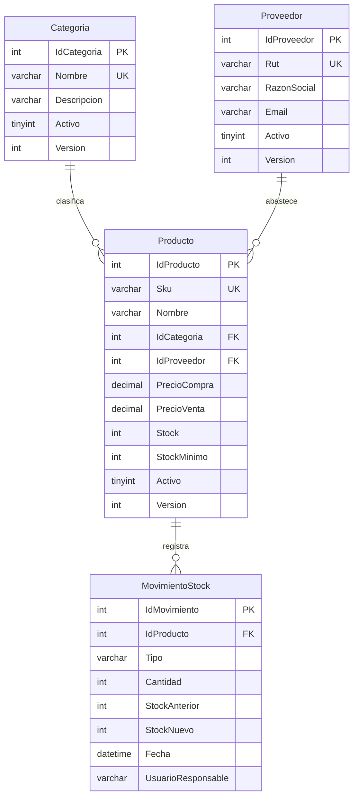
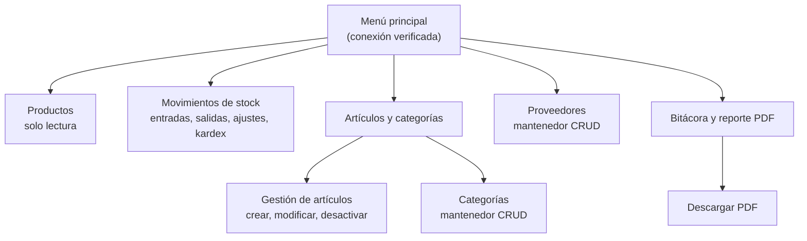

# Versión Final Multiplataforma (macOS) — SIGBIM

| Ficha del documento | |
|---|---|
| **Proyecto** | SIGBIM — Sistema de Gestión de Bodega de Insumos Médicos |
| **Asignatura** | Desarrollo e Ingeniería de Software (PRO205) |
| **Institución** | AIEP — Universidad Andrés Bello |
| **Estudiante** | Jonathan Felipe Urbina Monasterio — `JONATHAN.URBINA@correoaiep.cl` |
| **Documento** | `docs/10_Version_Final_macOS.md` |
| **Fecha de emisión** | octubre de 2026 |

Este documento describe la **versión final ejecutable** del mantenedor SIGBIM, construida y probada en macOS. Mantiene el mismo diseño de los documentos 01 a 09 (cuatro capas, procedimientos almacenados, integridad referencial y controles ISO/IEC 27001), pero con un alcance reducido a un **producto mínimo viable**, y agrega tres mejoras de uso: consulta de productos de solo lectura, un punto único para administrar el catálogo y la descarga de la bitácora en PDF.

---

## 1. Por qué existe una versión para macOS

| Aspecto | Proyecto base (documentos 01 a 09) | Versión final (este documento) |
|---|---|---|
| Interfaz | Windows Forms | **Avalonia UI** (mismo modelo de ventanas, controles y eventos) |
| Base de datos | SQL Server | **MySQL 8** |
| Sistema operativo | Windows | **macOS** (también Windows y Linux) |
| Capas BLL, DAL y Entidades | C# / .NET | C# / .NET 8 (misma estructura) |

Windows Forms depende de la API Win32 y **no se ejecuta en macOS**. Como el equipo de desarrollo es un Mac, la capa de presentación se implementó con Avalonia UI. Esto solo cambia la capa UI: las capas de negocio, acceso a datos y entidades siguen el mismo diseño, lo que también demuestra el bajo acoplamiento de la arquitectura (criterio 5 de la rúbrica).

## 2. Alcance del producto mínimo viable

La versión final se concentra en el núcleo del inventario: **4 tablas** con integridad referencial completa.



- Todas las claves foráneas usan `ON DELETE RESTRICT`: no se puede borrar una categoría o un proveedor que tenga productos. Por eso la aplicación usa **baja lógica** (`Activo = 0`, ISO A.5.33).
- Cada tabla maestra tiene columnas de auditoría (`FechaCreacion`, `UsuarioCreacion`, `FechaModificacion`, `UsuarioModificacion`) y un campo `Version` para el control de concurrencia optimista.
- La vista `vw_productodetalle` une Producto, Categoría y Proveedor y calcula margen, estado de stock y valor del inventario, sin duplicar datos (3FN).
- `CHECK` en la base de datos: precios ≥ 0, stock ≥ 0, cantidad > 0 y tipo ∈ {ENTRADA, SALIDA, AJUSTE}.

**Fuera del alcance (mejoras futuras):** las tablas `Usuario`, `Rol`, `Permiso`, `RolPermiso`, `UnidadMedida` y `Auditoria` del modelo completo. El diseño permite agregarlas sin modificar las 4 tablas actuales (ver sección 9).

## 3. Arquitectura y menú de la versión final

La solución `src/Sigbim.sln` tiene los cuatro proyectos de la arquitectura: `Sigbim.Entidades`, `Sigbim.DAL` (MySqlConnector, solo `CALL sp_…` con parámetros), `Sigbim.BLL` (reglas de negocio, validaciones y bitácora) y `Sigbim.UI` (Avalonia + QuestPDF). La UI **no** referencia la DAL.



<div class="figura">
  
  <div class="leyenda">Figura — Menú principal de la versión final, conectado a la base de datos.</div>
</div>

## 4. Funcionalidades agregadas en la versión final

### 4.1 Productos: consulta de solo lectura

El menú **Productos** muestra todos los productos registrados con buscador por SKU o nombre, categoría, proveedor, precios, stock, estado de stock y vencimiento. **No tiene formulario ni botones de edición**: seleccionar una fila no la abre para modificarla. Se implementó con un parámetro `soloLectura` en la plantilla genérica `VentanaMantenedor<T>`, de modo que la misma clase `VentanaProductos` sirve para la consulta y para la gestión, sin duplicar código.

### 4.2 Artículos y categorías: un único punto de administración

Todas las operaciones que **modifican el catálogo** quedaron en un solo apartado:

- **Gestión de artículos:** crear, modificar y desactivar productos (RF-01, RF-03, RF-04).
- **Categorías:** crear, listar, modificar y desactivar categorías (RF-05 a RF-08).

Separar la consulta de la gestión reduce las modificaciones accidentales y deja claro dónde se administra la información.

### 4.3 Bitácora y reporte PDF

| ID | Rol / Usuario | Necesidad / Acción | Criterio de aceptación | Criterio de seguridad (ISO 27001) |
|---|---|---|---|---|
| **RF-17** | Administrador / Auditor | Consultar la bitácora: inicios de sesión, creaciones, modificaciones, desactivaciones y movimientos. | La ventana lista todos los eventos (más reciente primero) con fecha, nivel, usuario, operación y detalle. | A.8.15 / A.8.16: revisión de la actividad. A.8.12: sin contraseñas ni cadena de conexión. |
| **RF-18** | Administrador / Auditor | Descargar la bitácora completa en PDF. | El PDF incluye quién lo generó, cuándo, el período cubierto, un resumen por usuario y por operación y el detalle cronológico. Se abre automáticamente. | A.8.15: cada exportación queda registrada (`Exportar bitácora PDF`), así que también es trazable quién extrajo la información. |

La lectura de la bitácora está en la BLL (`RegistroEventos.Leer()` y `BitacoraBLL`), la entidad `EventoBitacora` en la capa de Entidades y la generación del PDF (`ReporteBitacoraPdf`, con QuestPDF) en la UI, porque el PDF es un formato de presentación.

<div class="figura">
  
  <div class="leyenda">Figura — Primera página del reporte PDF de la bitácora generado por la aplicación.</div>
</div>

## 5. Seguridad aplicada (ISO/IEC 27001:2022)

| Control | Aplicación en la versión final | Evidencia |
|---|---|---|
| A.8.2 / A.8.3 Mínimo privilegio | La aplicación usa `sigbim_app`, que solo tiene `EXECUTE` sobre los SPs. | `SELECT` y `UPDATE` directos devuelven *ERROR 1142 … command denied*. |
| A.8.28 Codificación segura | Solo SPs con parámetros, sin SQL concatenado. | `Db.cs`: `CALL sp_…(@p_…)`. |
| A.5.17 / A.8.9 Credenciales | La cadena de conexión está en `appsettings.json` (excluido de Git) o en la variable `SIGBIM_CONEXION`. | `.gitignore` y `appsettings.example.json`. |
| A.8.15 Registro | Columnas de auditoría, kardex inmutable y bitácora `logs/` con descarga en PDF. | Bitácora y reporte PDF (sección 4.3). |
| A.8.12 Fuga de datos | El usuario ve mensajes comprensibles; el detalle técnico queda en la bitácora. | `TraductorErrores` y `Ui.EjecutarAsync`. |
| A.5.33 Protección de registros | Baja lógica en productos, categorías y proveedores. | `sp_*_eliminar` hace `Activo = 0`. |
| A.8.32 Gestión de cambios | Cada cambio tiene su propio commit descriptivo. | `git log --oneline`. |

## 6. Pruebas y evidencias

Se ejecutaron **25 casos de prueba**, todos aprobados (detalle completo en `docs/07_pruebas_y_evidencias.md` de la versión final).

| Nivel | Ejemplos | Casos | Aprobados |
|---|---|---|---|
| Instalación y compilación | Scripts SQL, `dotnet build` (0 errores, 0 advertencias), conexión al iniciar. | 4 | 4 |
| Mínimo privilegio | `CALL` permitido; `SELECT` y `UPDATE` directos rechazados. | 3 | 3 |
| Reglas de la BD | Stock insuficiente, cantidad 0, tipo inválido, producto inexistente, precio de venta menor al de compra, SKU y categoría duplicados. | 7 | 7 |
| Validaciones BLL | RUT módulo 11 y email inválidos, campos obligatorios, precios, no desactivar productos con stock. | 5 | 5 |
| Funcionales | Modificar producto, desactivar proveedor, entrada y salida de stock, exportar la bitácora, menú reorganizado. | 6 | 6 |
| **Total** | | **25** | **25** |

En las pruebas negativas de la base de datos se comprobó que **el stock no cambió** (GUA-001: 22.283 y PAR-500: 200, antes y después), lo que confirma que los SPs revierten la operación (ROLLBACK) ante un error.

### Incidente corregido durante la instalación

La aplicación recibía `ERROR 1045: Access denied for user 'sigbim_app'@'localhost'` aunque el usuario existía. La causa era una cuenta antigua `sigbim_app@localhost`, que MySQL prefería sobre la nueva `sigbim_app@%` por ser más específica. Se corrigió el script `02_seguridad_usuario_app.sql` para eliminar ambas cuentas antes de crear la nueva, y la corrección quedó en un commit propio.

## 7. Ejecución en macOS

```bash
# 1. Base de datos (pide la clave de root)
cd database
mysql -u root -p < 01_sigbim_inventario.sql
mysql -u root -p < 02_seguridad_usuario_app.sql

# 2. Configuración de la conexión
cd ../src/Sigbim.UI
cp appsettings.example.json appsettings.json   # ajustar la clave de sigbim_app si se cambió

# 3. Ejecutar
cd ..
dotnet run --project Sigbim.UI
```

Requisitos: .NET SDK 8 o superior y MySQL Server 8. La primera ejecución descarga los paquetes Avalonia, MySqlConnector y QuestPDF.

## 8. Correspondencia con la rúbrica

| Criterio | Cómo lo cumple la versión final |
|---|---|
| 1. Control de versiones | Repositorio con historial incremental: documentación, base de datos, cada capa y cada ajuste final en commits separados y descriptivos. |
| 2. Informe, tríada e ISO 27001 | Documentos 01 a 07 de la versión final; RF con tríada (incluidos RF-17 y RF-18) y matriz de controles. |
| 3. UML | Casos de uso (CU-01 a CU-16) y diagrama de clases por capa actualizados con el menú y la bitácora. |
| 4. BD, normalización y SPs | 4 tablas en 3FN con PK, FK, UNIQUE y CHECK; vista consolidada; CRUD completo con SPs. |
| 5. Arquitectura en 4 capas | UI → BLL → DAL → BD, con Entidades compartidas; la UI no referencia la DAL. |
| 6. Mantenedor CRUD | Crear, consultar, modificar y desactivar productos, categorías y proveedores, más movimientos de stock, todo mediante SPs. |
| 7. Validaciones y errores | Validación en UI (formato), BLL (reglas) y BD (restricciones y SPs); errores SQL traducidos a mensajes de usuario. |

## 9. Mejoras futuras

1. **Inicio de sesión con usuarios y roles** (`Usuario`, `Rol`, `Permiso`, `RolPermiso`): las columnas de auditoría pasarían de texto a claves foráneas hacia `Usuario`.
2. **Unidad de medida**: `CREATE TABLE UnidadMedida` + `ALTER TABLE Producto ADD IdUnidadMedida`.
3. **Auditoría en base de datos**: tabla `Auditoria` con triggers, como complemento de la bitácora de archivos.
4. **Filtros del reporte PDF** por fecha, usuario u operación.
5. **Botón "Volver al inicio"** en cada ventana (hoy se vuelve cerrando la ventana).
